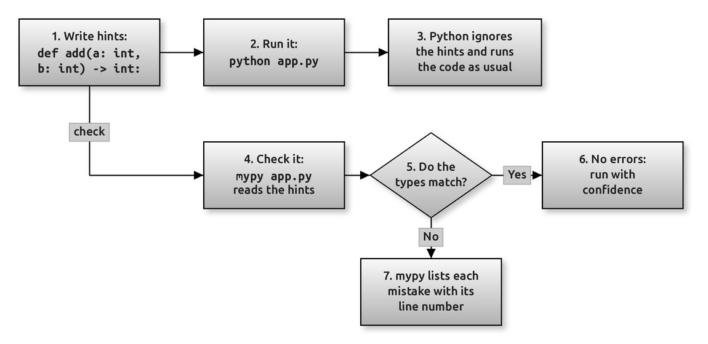

# Type Hints: Saying Which Types a Function Expects

A **type hint** is a short note in your code that says which type of value a variable should hold, which types a function expects for its parameters, and which type it returns. Python has supported them since version 3.5, and you will see them in almost every modern library and tutorial.

The surprising thing for a beginner is this: **Python itself does not check type hints when your program runs.** They are written for people who read the code, for editors such as VS Code that underline mistakes as you type, and for checking tools such as **mypy** that read the hints and report problems *before* you run anything.

This page starts from the functions you met in Chapters 5 and 6 and adds hints to them, one idea at a time. By the end of this page you should be able to:

- read a function signature such as `def average(marks: list[int]) -> float:` and say what it promises;
- add hints to variables, parameters and return values, including lists, dictionaries and tuples;
- write a hint for a value that may be missing (`str | None`) or that may be one of two types (`int | float`);
- explain why a hint does not convert a value or stop a wrong value from being passed;
- install mypy and use it to find type mistakes in a script;
- see where hints are not optional at all: in a `@dataclass`, which you meet in Chapter 16.

You need Chapter 5 (functions) first. Section 9 uses a dataclass; if you have not read Chapter 16 yet, you can come back to it later.

## Table of Contents

- [Type Hints: Saying Which Types a Function Expects](010-ch6-type-hints.md#type-hints-saying-which-types-a-function-expects)
    - [Key Terms Used on This Page](010-ch6-type-hints.md#key-terms-used-on-this-page)
    - [1. What a Type Hint Looks Like](010-ch6-type-hints.md#1-what-a-type-hint-looks-like)
    - [2. Python Does Not Check Hints When It Runs](010-ch6-type-hints.md#2-python-does-not-check-hints-when-it-runs)
    - [3. Hints for Variables and Containers](010-ch6-type-hints.md#3-hints-for-variables-and-containers)
    - [4. A Value That Might Be Missing: X | None](010-ch6-type-hints.md#4-a-value-that-might-be-missing-x--none)
    - [5. More Than One Type, and Functions That Return Nothing](010-ch6-type-hints.md#5-more-than-one-type-and-functions-that-return-nothing)
    - [6. A Hint Does Not Convert a Value](010-ch6-type-hints.md#6-a-hint-does-not-convert-a-value)
    - [7. Reading Hints in Real Code](010-ch6-type-hints.md#7-reading-hints-in-real-code)
    - [8. Checking Hints with mypy](010-ch6-type-hints.md#8-checking-hints-with-mypy)
        - [Installing mypy](010-ch6-type-hints.md#installing-mypy)
        - [Running mypy on the First Script](010-ch6-type-hints.md#running-mypy-on-the-first-script)
        - [A Second Example: Two Real Mistakes](010-ch6-type-hints.md#a-second-example-two-real-mistakes)
    - [9. Where Hints Are Required: Dataclasses](010-ch6-type-hints.md#9-where-hints-are-required-dataclasses)
    - [10. Common Mistakes](010-ch6-type-hints.md#10-common-mistakes)
    - [Using the Code](010-ch6-type-hints.md#using-the-code)
    - [Conceptual Questions](010-ch6-type-hints.md#conceptual-questions)
        - [Question 1: Does a Type Hint Make Python Safer at Run Time?](010-ch6-type-hints.md#question-1-does-a-type-hint-make-python-safer-at-run-time)
        - [Question 2: What Does -> str | None Tell the Caller?](010-ch6-type-hints.md#question-2-what-does---str--none-tell-the-caller)
        - [Question 3: Why Are Hints Most Useful on Function Signatures?](010-ch6-type-hints.md#question-3-why-are-hints-most-useful-on-function-signatures)
        - [Question 4: A Function Is Hinted def area(r: float) -> float:. Is area(5) a Mistake?](010-ch6-type-hints.md#question-4-a-function-is-hinted-def-arear-float---float-is-area5-a-mistake)
        - [Question 5: When Should a Beginner Start Using Type Hints?](010-ch6-type-hints.md#question-5-when-should-a-beginner-start-using-type-hints)
    - [Key Takeaways](010-ch6-type-hints.md#key-takeaways)
    - [Further Reading](010-ch6-type-hints.md#further-reading)

## Key Terms Used on This Page

| Term | Simple Meaning | Learn More |
| --- | --- | --- |
| Type hint (annotation) | A note that says which type a variable, parameter or return value should have, written after a colon or after `->` | [Python docs: typing](https://docs.python.org/3/library/typing.html) |
| Signature | The first line of a function: its name, its parameters and (with hints) its return type | [Python glossary: function annotation](https://docs.python.org/3/glossary.html#term-function-annotation) |
| Return type | The type of the value a function gives back, written after `->` | |
| `__annotations__` | A dictionary in which Python stores the hints of a function or class | [Python HOWTO: Annotations Best Practices](https://docs.python.org/3/howto/annotations.html) |
| Static type checker | A tool that reads your code and its hints *without running it* and reports type mistakes | [mypy documentation](https://mypy.readthedocs.io/en/stable/) |
| mypy | The most widely used static type checker for Python | [mypy: Getting started](https://mypy.readthedocs.io/en/stable/getting_started.html) |
| Union type | A hint that allows more than one type, written with `\|`, such as `int \| float` | [Python docs: Union type](https://docs.python.org/3/library/stdtypes.html#types-union) |
| `None` | Python's "no value" object. A function that returns nothing returns `None` | [Python docs: None](https://docs.python.org/3/library/constants.html#None) |
| Dataclass | A class whose fields are created automatically from its type hints | [Python docs: dataclasses](https://docs.python.org/3/library/dataclasses.html) |
| PEP 484 | The Python Enhancement Proposal that introduced type hints | [PEP 484](https://peps.python.org/pep-0484/) |

[Back to the Table of Contents](010-ch6-type-hints.md#table-of-contents)

## 1. What a Type Hint Looks Like

You already know how to write a function:

```python
def add(a, b):
    return a + b
```

A reader cannot tell from this line whether `a` and `b` should be numbers, strings or lists, because `+` works on all of them. Type hints answer that question in the signature itself:

- after each parameter, a colon and a type: `a: int`;
- after the closing bracket, an arrow and the return type: `-> int`.

```python
# A function with type hints on its parameters and its return value
def add(a: int, b: int) -> int:
    return a + b

print(add(3, 4))          # Two integers, as the hints say
print(add(2.5, 1.5))      # Floats: the hints say int, but Python runs it anyway
print(add("3", "4"))      # Strings: + joins them, so the result is "34"
```

Output:

```text
7
4.0
34
```

Read the signature `def add(a: int, b: int) -> int:` aloud as "add takes two integers and returns an integer". That is the whole purpose of the hint: it is a promise about how the function is meant to be used.

Now look at the second and third calls. The hints say `int`, yet Python happily added two floats and joined two strings. **Nothing stopped the wrong values.** This is not a bug. It is how type hints are designed, and the next section explains why.

[Back to the Table of Contents](010-ch6-type-hints.md#table-of-contents)

## 2. Python Does Not Check Hints When It Runs

When Python runs a function definition, it reads the hints and stores them in a dictionary called `__annotations__`. After that it ignores them. Calling the function works exactly as it would without any hints.

```python
def greet(name: str, times: int = 1) -> str:
    return ("Hello, " + name + "! ") * times

# Python stores the hints in a dictionary on the function...
print(greet.__annotations__)

# ...but does not use them to check anything when the function runs
print(greet("Asha", 2))
print(greet("Ravi"))                 # times takes its default value, 1
```

Output:

```text
{'name': <class 'str'>, 'times': <class 'int'>, 'return': <class 'str'>}
Hello, Asha! Hello, Asha! 
Hello, Ravi! 
```

The first line of output shows the stored hints: two parameters and the return type, saved under the key `'return'`. Python keeps them so that tools can read them. It never uses them to refuse a call.

Why design it this way?

1. **Speed.** Checking every argument on every call would slow every program down.
2. **Freedom.** Python is dynamically typed (Chapter 1). Hints are optional, so old code without them still runs, and you can add them a little at a time.
3. **Earlier warnings.** A checker such as mypy finds mistakes *before* the program runs, which is better than finding them halfway through a run. Section 8 shows how.

[Back to the Table of Contents](010-ch6-type-hints.md#table-of-contents)

## 3. Hints for Variables and Containers

A variable gets a hint in the same way: name, colon, type, then the value.

For containers (lists, dictionaries, tuples and sets), the type of the items goes inside square brackets:

| Hint | Meaning |
| --- | --- |
| `list[int]` | a list whose items are all integers |
| `dict[str, float]` | a dictionary with string keys and float values |
| `tuple[int, int]` | a tuple of exactly two integers |
| `tuple[int, ...]` | a tuple of any length, all integers |
| `set[str]` | a set of strings |

```python
# Hints for variables: name, colon, type, then the value
city: str = "Pune"
population: int = 7_400_000
area_sq_km: float = 331.26
is_capital: bool = False

# Hints for containers: the type inside the brackets is the type of the items
marks: list[int] = [72, 85, 90]
prices: dict[str, float] = {"tea": 12.0, "coffee": 25.5}
point: tuple[int, int] = (3, 4)
subjects: set[str] = {"Maths", "Physics"}

print(city, population, area_sq_km, is_capital)
print(marks, prices, point, sorted(subjects))
```

Output:

```text
Pune 7400000 331.26 False
[72, 85, 90] {'tea': 12.0, 'coffee': 25.5} (3, 4) ['Maths', 'Physics']
```

Two points to notice:

- `7_400_000` is just `7400000`. Underscores in a number make it easier to read, and Python ignores them.
- You will meet older code that writes `List[int]` and `Dict[str, float]` with capital letters, imported from the `typing` module. That was needed before Python 3.9. Today the built-in names `list`, `dict`, `tuple` and `set` work directly, and they are what this page uses.

Most of the time you do **not** need to hint simple variables. `city = "Pune"` is obviously a string, and mypy works that out by itself. Hints are most useful on function parameters and return values, where the type is not obvious from the line itself.

[Back to the Table of Contents](010-ch6-type-hints.md#table-of-contents)

## 4. A Value That Might Be Missing: `X | None`

Many functions sometimes have nothing to return. `dict.get()` is a good example: it returns the value if the key exists, and `None` if it does not. The hint for "an `int`, or `None`" is `int | None`.

```python
def find_roll_number(name: str, register: dict[str, int]) -> int | None:
    """Return the roll number, or None if the name is not in the register."""
    return register.get(name)

register = {"Asha": 101, "Ravi": 102}

for student in ["Asha", "Meena"]:
    roll = find_roll_number(student, register)
    if roll is None:
        print(f"{student}: not found")
    else:
        print(f"{student}: roll number {roll}")
```

Output:

```text
Asha: roll number 101
Meena: not found
```

The hint `-> int | None` is a warning to whoever calls the function: *check for `None` before you use the result.* That is exactly what the `if roll is None:` line does. If you forgot that check and wrote `roll + 1`, mypy would point out that `roll` might be `None`.

You will also see this written as `Optional[int]`, imported from `typing`. It means the same as `int | None`; the `|` form needs Python 3.10 or later.

[Back to the Table of Contents](010-ch6-type-hints.md#table-of-contents)

## 5. More Than One Type, and Functions That Return Nothing

The same `|` allows any combination of types. `int | float` means "an integer or a float".

A function that only prints, or only changes something, returns `None`. Its return hint is therefore `-> None`.

```python
def to_rupees(amount: int | float) -> str:
    """Accept an int or a float, return a formatted string."""
    return f"Rs {amount:,.2f}"

def show_total(items: list[float]) -> None:
    """This function prints; it returns nothing, so the hint is None."""
    print("Total:", to_rupees(sum(items)))

print(to_rupees(1500))
print(to_rupees(99.5))
show_total([120.0, 35.5, 9.25])
```

Output:

```text
Rs 1,500.00
Rs 99.50
Total: Rs 164.75
```

`show_total()` prints a line but has no `return` statement, so it gives back `None`. Writing `-> None` tells the reader not to expect a result from it. A common beginner mistake is to write `total = show_total(...)` and then wonder why `total` is `None`; the hint makes that mistake easy to spot.

[Back to the Table of Contents](010-ch6-type-hints.md#table-of-contents)

## 6. A Hint Does Not Convert a Value

This is the misunderstanding that causes the most confusion. A hint describes what *should* arrive. It does not change what actually arrives.

```python
def double(n: int) -> int:
    return n * 2

value = input("Enter a number: ")   # input() always returns a str
print(double(value))                # The hint does NOT turn "21" into 21
print(double(int(value)))           # Converting is still your job
```

Output (typing `21`):

```text
Enter a number: 21
2121
42
```

`input()` always returns a string, so `value` is `"21"`. The hint `n: int` does not turn it into `21`. Inside `double()`, `"21" * 2` repeats the string and gives `2121`. Only `int(value)` gives the arithmetic answer, `42`.

So converting and checking input is still your job, exactly as in Chapter 9. Hints help you *notice* that a conversion is missing: mypy reports that `double()` was given a `str` where it expects an `int`.

[Back to the Table of Contents](010-ch6-type-hints.md#table-of-contents)

## 7. Reading Hints in Real Code

Once you can read hints, the documentation of most libraries becomes much clearer. Here are some signatures in the style you will meet, and how to read them:

| Signature | Read it as |
| --- | --- |
| `def mean(values: list[float]) -> float:` | takes a list of floats, returns one float |
| `def find(name: str) -> str \| None:` | returns a string, or `None` if nothing is found |
| `def load(path: str, strict: bool = False) -> dict[str, int]:` | `strict` is optional and defaults to `False`; the result maps strings to integers |
| `def log(*messages: str) -> None:` | any number of string arguments; returns nothing |
| `def settings(**options: int) -> None:` | any number of keyword arguments, each an integer |

Notice the last two. With `*args` and `**kwargs` (Chapter 6), the hint describes **each** argument, not the tuple or dictionary that collects them.

A default value goes **after** the hint: `strict: bool = False`. Writing `strict = False: bool` is a syntax error.

[Back to the Table of Contents](010-ch6-type-hints.md#table-of-contents)

## 8. Checking Hints with mypy

Because Python ignores hints when it runs, you need a separate tool to check them. **mypy** reads your file, compares every call and assignment with the hints, and reports anything that does not fit. It does not run your code.



**Reading the figure**

- **Step 1:** You write hints in your code, for example `def add(a: int, b: int) -> int:`.
- **Step 2:** You run the program in the usual way, with `python app.py`.
- **Step 3:** Python stores the hints but ignores them. The code runs as usual, even if a wrong type is passed.
- **Step 4:** Separately, you run `mypy app.py`. mypy reads the hints without running the program.
- **Step 5:** mypy compares every call and assignment with the hints.
- **Step 6:** If everything matches, mypy reports no errors, and you can run the program with more confidence.
- **Step 7:** If something does not match, mypy lists each mistake with its line number, before the program has run at all.

### Installing mypy

mypy is a separate package. Install it once, from a terminal (on Windows, the Command Prompt or the VS Code terminal):

```text
python -m pip install mypy
```

In a Colab or Jupyter cell, use `!pip install mypy` instead.

### Running mypy on the First Script

Save the script from Section 1 as `th01_first_hints.py` and run:

```text
python -m mypy th01_first_hints.py
```

Output:

```text
th01_first_hints.py:6: error: Argument 1 to "add" has incompatible type "float"; expected "int"  [arg-type]
th01_first_hints.py:6: error: Argument 2 to "add" has incompatible type "float"; expected "int"  [arg-type]
th01_first_hints.py:7: error: Argument 1 to "add" has incompatible type "str"; expected "int"  [arg-type]
th01_first_hints.py:7: error: Argument 2 to "add" has incompatible type "str"; expected "int"  [arg-type]
Found 4 errors in 1 file (checked 1 source file)
```

Each line gives the file, the line number, what is wrong, and (in square brackets) the kind of error. The calls on lines 6 and 7 pass floats and strings to a function that expects integers. Python ran those lines without complaint in Section 1; mypy catches them without running anything.

### A Second Example: Two Real Mistakes

```python
def average(marks: list[int]) -> float:
    return sum(marks) / len(marks)

result: float = average([72, 85, 90])
print(result)

label: str = average([60, 70])      # Mistake 1: a float stored in a str variable
print(average(["72", "85"]))        # Mistake 2: a list of str, not a list of int
```

Running it with Python prints the first result and then crashes on the last line:

```text
82.33333333333333
Traceback (most recent call last):
  File "th06_mypy_demo.py", line 8, in <module>
    print(average(["72", "85"]))        # Mistake 2: a list of str, not a list of int
          ~~~~~~~^^^^^^^^^^^^^^
  File "th06_mypy_demo.py", line 2, in average
    return sum(marks) / len(marks)
           ~~~^^^^^^^
TypeError: unsupported operand type(s) for +: 'int' and 'str'
```

Running mypy on the same file finds **both** mistakes at once, before the program runs:

```text
th06_mypy_demo.py:7: error: Incompatible types in assignment (expression has type "float", variable has type "str")  [assignment]
th06_mypy_demo.py:8: error: List item 0 has incompatible type "str"; expected "int"  [list-item]
th06_mypy_demo.py:8: error: List item 1 has incompatible type "str"; expected "int"  [list-item]
Found 3 errors in 1 file (checked 1 source file)
```

Notice that mistake 1 (line 7) would never have crashed: Python would simply have stored a float in a variable called `label` that is supposed to hold text, and the problem would have appeared somewhere else, much later. That is the kind of bug a type checker is best at finding.

In VS Code, the Python extension (Pylance) does a similar check as you type and underlines the mistakes in red, so you often see them without running mypy at all.

[Back to the Table of Contents](010-ch6-type-hints.md#table-of-contents)

## 9. Where Hints Are Required: Dataclasses

Everywhere else on this page, hints are optional. In a **dataclass** they are not. The `@dataclass` decorator (Chapter 16) reads the hints in the class body and uses them to create the fields and the `__init__()` method for you.

```python
from dataclasses import dataclass

@dataclass
class Student:
    name: str            # In a dataclass the hints are required:
    roll: int            # they tell @dataclass which fields to create
    marks: float = 0.0

s = Student("Asha", 101, 88.5)
print(s)
print(Student.__annotations__)
```

Output:

```text
Student(name='Asha', roll=101, marks=88.5)
{'name': <class 'str'>, 'roll': <class 'int'>, 'marks': <class 'float'>}
```

Without the hints, `@dataclass` would create no fields at all. Even here, though, the hints are not enforced: `Student("Asha", "one hundred and one")` would still run. Only a checker such as mypy would object.

[Back to the Table of Contents](010-ch6-type-hints.md#table-of-contents)

## 10. Common Mistakes

| Mistake | What happens | Fix |
| --- | --- | --- |
| Expecting a hint to stop a wrong value | The wrong value is accepted and the error appears later, or not at all | Run mypy, or check the value yourself with `isinstance()` |
| Expecting a hint to convert a value | `"21"` stays a string | Convert explicitly: `int(value)` |
| Writing the default before the hint: `n = 0: int` | `SyntaxError` | Write `n: int = 0` |
| Forgetting `-> None` on a function that only prints | Nothing breaks, but readers may expect a result | Add `-> None` |
| Using `list[int]` on Python 3.8 or older | `TypeError` when the function is defined | Upgrade Python, or use `List[int]` from `typing` |
| Writing `int \| None` on Python 3.9 or older | `TypeError` | Use `Optional[int]` from `typing`, or upgrade |
| Hinting every simple variable | Cluttered code that is harder to read | Hint parameters and return values; let the checker work out the rest |

[Back to the Table of Contents](010-ch6-type-hints.md#table-of-contents)

## Using the Code

Every script on this page is complete and ready to run. Copy it into a `.py` file or a notebook cell. The output shown under each script was produced by running it.

| Script | Section | What it shows |
| --- | --- | --- |
| `th01_first_hints.py` | 1 and 8 | Hints on a function; wrong types still run |
| `th02_annotations.py` | 2 | Where Python stores the hints |
| `th03_basic_types.py` | 3 | Hints for variables and containers |
| `th04_optional.py` | 4 | A result that may be `None` |
| `th05_union_none.py` | 5 | `int \| float`, and `-> None` |
| `th08_hint_is_not_conversion.py` | 6 | A hint does not convert `input()` |
| `th06_mypy_demo.py` | 8 | Two mistakes that mypy finds |
| `th07_dataclass.py` | 9 | Hints that create dataclass fields |

The outputs were produced with Python 3.13 and mypy 2.4. On other versions the wording of mypy's messages may differ slightly, but the mistakes it finds are the same. The `X | None` form needs Python 3.10 or later; Google Colab already has a suitable version.

[Back to the Table of Contents](010-ch6-type-hints.md#table-of-contents)

## Conceptual Questions

### Question 1: Does a Type Hint Make Python Safer at Run Time?

**Answer:** Not by itself. Python stores the hints in `__annotations__` and then ignores them, so a function hinted with `int` still accepts a string. Hints make a program safer only when something reads them: a checker such as mypy, an editor such as VS Code, or a library such as `dataclasses` that uses them for its own purpose.

### Question 2: What Does `-> str | None` Tell the Caller?

**Answer:** That the function returns either a string or `None`, usually `None` when it has nothing to give back. The caller should check `if result is None:` before using the result as a string. mypy will report any place where the result is used as a string without that check.

### Question 3: Why Are Hints Most Useful on Function Signatures?

**Answer:** Inside a function, the type of a variable is usually clear from the line that creates it: `count = 0` is obviously an integer. At a function's signature the reader cannot see the calling code, so the hints are the only place that says what the function expects and returns. They also act as short documentation that cannot drift out of date as easily as a comment, because mypy checks them.

### Question 4: A Function Is Hinted `def area(r: float) -> float:`. Is `area(5)` a Mistake?

**Answer:** No. mypy accepts an `int` wherever a `float` is expected, because every integer can be used as a float. The reverse is not true: passing `5.0` to a parameter hinted `int` is reported as a mistake.

### Question 5: When Should a Beginner Start Using Type Hints?

**Answer:** As soon as you write functions that other people (or you, a month later) will call. Start with the parameters and return value of each function, keep them simple, and run mypy now and then. There is no need to hint every variable or to learn the advanced parts of the `typing` module at first.

[Back to the Table of Contents](010-ch6-type-hints.md#table-of-contents)

## Key Takeaways

| Idea | In one line |
| --- | --- |
| What a hint is | A note saying which type is expected: `name: str`, `-> int` |
| What Python does with it | Stores it in `__annotations__` and otherwise ignores it |
| What mypy does with it | Reads it and reports mismatches before the program runs |
| Containers | `list[int]`, `dict[str, float]`, `tuple[int, int]`, `set[str]` |
| Maybe missing | `str \| None` (or `Optional[str]` in older code) |
| Returns nothing | `-> None` |
| Where hints are required | In a `@dataclass`, where they create the fields |
| What a hint never does | Convert a value or stop a wrong one from being passed |

[Back to the Table of Contents](010-ch6-type-hints.md#table-of-contents)

## Further Reading

- [Python docs: `typing`, support for type hints](https://docs.python.org/3/library/typing.html)
- [Python HOWTO: Annotations Best Practices](https://docs.python.org/3/howto/annotations.html)
- [mypy: Type hints cheat sheet](https://mypy.readthedocs.io/en/stable/cheat_sheet_py3.html)
- [mypy: Getting started](https://mypy.readthedocs.io/en/stable/getting_started.html)
- [PEP 484: Type Hints](https://peps.python.org/pep-0484/)
- [PEP 604: Allow writing union types as `X | Y`](https://peps.python.org/pep-0604/)
- [Using `functools.wraps` in Decorators](009-ch6-functools-decorators.md), which mentions where the hints of a decorated function go

[Back to the Table of Contents](010-ch6-type-hints.md#table-of-contents)
