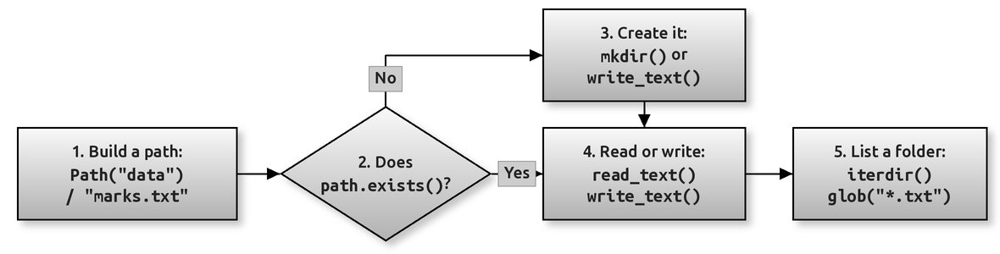

# Working with Files and Folders Using pathlib

Chapter 10 of the book opens files by name, as plain strings such as `"marks.txt"`, and the page on [the os Module](060-ch10-os-module.md) shows how `os` and `os.path` work with folders. Since Python 3.4 there has been a neater way: the **`pathlib`** module. Instead of treating a path as a piece of text, `pathlib` gives you a **`Path` object** that knows it is a path. You build paths with the `/` operator, ask a path questions such as "does this exist?" or "what is the extension?", and read or write a whole file in one line.

Most modern Python code, and most current documentation, uses `pathlib`. It is worth learning even if you already know `os.path`, because the code is shorter, easier to read, and works the same way on Windows, macOS and Linux.

By the end of this page you should be able to:

- build a path from pieces with `/`, and take a path apart into its name, stem, extension and parent folder;
- check whether a file or folder exists, and create folders safely with `mkdir()`;
- read and write a whole text file with `read_text()` and `write_text()`, and use a `Path` with `open()`;
- list what is inside a folder with `iterdir()`, `glob()` and `rglob()`;
- rename and delete files and empty folders;
- choose between `pathlib` and `os.path` when you read other people's code.

You need Chapter 10 (opening, reading and writing files) first. The page on [Walking a Folder Tree with os.walk](140-ch10-oswalk.md) is useful background but not required.

## Table of Contents

- [Working with Files and Folders Using pathlib](150-ch10-pathlib.md#working-with-files-and-folders-using-pathlib)
    - [Key Terms Used on This Page](150-ch10-pathlib.md#key-terms-used-on-this-page)
    - [1. Why pathlib?](150-ch10-pathlib.md#1-why-pathlib)
    - [2. The Usual Workflow](150-ch10-pathlib.md#2-the-usual-workflow)
    - [3. Building a Path and Taking It Apart](150-ch10-pathlib.md#3-building-a-path-and-taking-it-apart)
    - [4. Checking and Creating Folders](150-ch10-pathlib.md#4-checking-and-creating-folders)
    - [5. Reading and Writing Text Files](150-ch10-pathlib.md#5-reading-and-writing-text-files)
    - [6. Listing a Folder: iterdir(), glob() and rglob()](150-ch10-pathlib.md#6-listing-a-folder-iterdir-glob-and-rglob)
    - [7. Renaming and Deleting](150-ch10-pathlib.md#7-renaming-and-deleting)
    - [8. A Complete Example: Tidying a Downloads Folder](150-ch10-pathlib.md#8-a-complete-example-tidying-a-downloads-folder)
    - [9. Common Mistakes](150-ch10-pathlib.md#9-common-mistakes)
    - [Using the Code](150-ch10-pathlib.md#using-the-code)
    - [Conceptual Questions](150-ch10-pathlib.md#conceptual-questions)
        - [Question 1: What Is the Difference Between a Path and a File?](150-ch10-pathlib.md#question-1-what-is-the-difference-between-a-path-and-a-file)
        - [Question 2: Why Is Path("data") / "marks.txt" Better Than "data" + "/" + "marks.txt"?](150-ch10-pathlib.md#question-2-why-is-pathdata--markstxt-better-than-data----markstxt)
        - [Question 3: When Would You Use open() Instead of read_text()?](150-ch10-pathlib.md#question-3-when-would-you-use-open-instead-of-read_text)
        - [Question 4: Why Do iterdir() and glob() Need sorted() in These Examples?](150-ch10-pathlib.md#question-4-why-do-iterdir-and-glob-need-sorted-in-these-examples)
        - [Question 5: Is os.path Now Wrong?](150-ch10-pathlib.md#question-5-is-ospath-now-wrong)
    - [Key Takeaways](150-ch10-pathlib.md#key-takeaways)
    - [Further Reading](150-ch10-pathlib.md#further-reading)

## Key Terms Used on This Page

| Term | Simple Meaning | Learn More |
| --- | --- | --- |
| Path | The location of a file or folder, such as `school/class10/marks.txt` | [Python docs: pathlib](https://docs.python.org/3/library/pathlib.html) |
| `Path` object | A `pathlib` object that represents a path and has methods to inspect and use it | [Python docs: pathlib.Path](https://docs.python.org/3/library/pathlib.html#pathlib.Path) |
| Relative path | A path measured from the current working directory, such as `data/marks.txt` | [Python docs: Path.is_absolute()](https://docs.python.org/3/library/pathlib.html#pathlib.PurePath.is_absolute) |
| Absolute path | A path that starts from the top of the drive, such as `C:\Users\Asha\marks.txt` | [Python docs: Path.resolve()](https://docs.python.org/3/library/pathlib.html#pathlib.Path.resolve) |
| Current working directory | The folder your program is running in. Relative paths start from here | [Python docs: Path.cwd()](https://docs.python.org/3/library/pathlib.html#pathlib.Path.cwd) |
| Stem | The file name without its extension: `marks` in `marks.txt` | [Python docs: PurePath.stem](https://docs.python.org/3/library/pathlib.html#pathlib.PurePath.stem) |
| Suffix | The extension, including the dot: `.txt` | [Python docs: PurePath.suffix](https://docs.python.org/3/library/pathlib.html#pathlib.PurePath.suffix) |
| Glob pattern | A simple pattern for matching names, such as `*.txt` for "every name ending in .txt" | [Python docs: Path.glob()](https://docs.python.org/3/library/pathlib.html#pathlib.Path.glob) |
| Encoding | The rule for turning text into bytes on disk. `utf-8` is the safe choice | [Python docs: open()](https://docs.python.org/3/library/functions.html#open) |

[Back to the Table of Contents](150-ch10-pathlib.md#table-of-contents)

## 1. Why pathlib?

Here is the same task done the old way and the new way: build the path `school/class10/marks.txt` and get its extension.

```python
import os
from pathlib import Path

# The same path built both ways
old_style = os.path.join("school", "class10", "marks.txt")
new_style = Path("school") / "class10" / "marks.txt"

print(old_style)
print(new_style)
print("Same path?", Path(old_style) == new_style)

# Getting the extension
print(os.path.splitext(old_style)[1], "|", new_style.suffix)

# Where is this script running from?
print("cwd is a folder:", Path.cwd().is_dir())
```

Output (on Linux or macOS):

```text
school/class10/marks.txt
school/class10/marks.txt
Same path? True
.txt | .txt
cwd is a folder: True
```

On Windows, the first two lines show backslashes instead: `school\class10\marks.txt`. That is the point. **You write the path once, with `/`, and pathlib uses the right separator for the computer it runs on.**

| Task | `os` and `os.path` | `pathlib` |
| --- | --- | --- |
| Join pieces | `os.path.join("a", "b.txt")` | `Path("a") / "b.txt"` |
| File name | `os.path.basename(p)` | `p.name` |
| Extension | `os.path.splitext(p)[1]` | `p.suffix` |
| Parent folder | `os.path.dirname(p)` | `p.parent` |
| Exists? | `os.path.exists(p)` | `p.exists()` |
| Make folders | `os.makedirs(p, exist_ok=True)` | `p.mkdir(parents=True, exist_ok=True)` |
| Read whole file | `open(p).read()` | `p.read_text()` |
| List a folder | `os.listdir(p)` | `p.iterdir()` |
| Current folder | `os.getcwd()` | `Path.cwd()` |

With `os.path`, every operation is a separate function that takes a string. With `pathlib`, the path is an object and the operations are its methods and attributes, so related things stay together.

[Back to the Table of Contents](150-ch10-pathlib.md#table-of-contents)

## 2. The Usual Workflow

Most programs that work with files follow the same few steps. The flowchart shows them, with the `pathlib` method used at each step.



**Reading the figure**

- **Step 1:** Build the path from its pieces, for example `Path("data") / "marks.txt"`. Nothing is read or created yet; this only describes a location.
- **Step 2:** Ask whether it exists, with `path.exists()` (or `is_file()` and `is_dir()` to be more specific).
- **Step 3:** If it does not exist, create it: `mkdir()` for a folder, or `write_text()` for a file.
- **Step 4:** Read it with `read_text()`, or write to it with `write_text()` (or `open()` for line-by-line work).
- **Step 5:** List what a folder contains with `iterdir()`, or find particular files with `glob("*.txt")`.

The rest of this page takes these steps one at a time. **Run the scripts in order, in the same folder**, because later scripts use the files that earlier ones create. Every script works inside a folder called `pathlib_demo`, so nothing else on your computer is touched.

[Back to the Table of Contents](150-ch10-pathlib.md#table-of-contents)

## 3. Building a Path and Taking It Apart

`Path("school")` creates a path. The `/` operator adds a piece to the end. It works between a `Path` and a string, and the result is a new `Path`.

```python
from pathlib import Path

# 1. Build a path from pieces with the / operator
folder = Path("school")
report = folder / "class10" / "marks.txt"
print("Path      :", report)

# 2. Take a path apart
print("name      :", report.name)      # last part, with extension
print("stem      :", report.stem)      # last part, without extension
print("suffix    :", report.suffix)    # the extension, with the dot
print("parent    :", report.parent)    # everything except the last part
print("parts     :", report.parts)     # all the pieces as a tuple

# 3. Change one piece and get a NEW path (the old one is unchanged)
print("with_suffix:", report.with_suffix(".csv"))
print("with_name  :", report.with_name("attendance.txt"))
```

Output (on Linux or macOS):

```text
Path      : school/class10/marks.txt
name      : marks.txt
stem      : marks
suffix    : .txt
parent    : school/class10
parts     : ('school', 'class10', 'marks.txt')
with_suffix: school/class10/marks.csv
with_name  : school/class10/attendance.txt
```

Points to notice:

1. **Building a path does not create anything on disk.** `school/class10/marks.txt` is only a description of a location. The folders do not need to exist.
2. `name`, `stem`, `suffix`, `parent` and `parts` are **attributes**, so they have no brackets.
3. `with_suffix()` and `with_name()` return a **new** path. A `Path`, like a string, is never changed in place.
4. On Windows the output shows backslashes, for example `school\class10\marks.txt`. Your code stays the same.

[Back to the Table of Contents](150-ch10-pathlib.md#table-of-contents)

## 4. Checking and Creating Folders

Before you write into a folder, it must exist. `mkdir()` creates it. Two keyword arguments make it safe to use:

- `parents=True` also creates any missing parent folders, like `os.makedirs()`;
- `exist_ok=True` means "do nothing, and raise no error, if the folder is already there".

```python
from pathlib import Path

base = Path("pathlib_demo")
notes = base / "notes"

print("Before:", base.exists(), notes.exists())

# parents=True creates missing parent folders too;
# exist_ok=True means "no error if the folder is already there"
notes.mkdir(parents=True, exist_ok=True)

print("After :", base.exists(), notes.exists())
print("Is notes a folder?", notes.is_dir())
print("Is notes a file?  ", notes.is_file())

notes.mkdir(parents=True, exist_ok=True)    # Running it again is safe
print("Second mkdir() caused no error")
```

Output:

```text
Before: False False
After : True True
Is notes a folder? True
Is notes a file?   False
Second mkdir() caused no error
```

Without `exist_ok=True`, the second `mkdir()` would raise `FileExistsError`. Without `parents=True`, creating `pathlib_demo/notes` would raise `FileNotFoundError` when `pathlib_demo` does not exist yet. Using both together is the usual, safe habit.

`exists()` is true for files **and** folders. When it matters which one you have, use `is_file()` or `is_dir()`.

[Back to the Table of Contents](150-ch10-pathlib.md#table-of-contents)

## 5. Reading and Writing Text Files

For small files, `write_text()` and `read_text()` do the whole job in one call: open the file, write or read everything, and close it. For line-by-line work, a `Path` can be given to `open()`, or you can call the path's own `open()` method, exactly as you did with file names in Chapter 10.

```python
from pathlib import Path

notes = Path("pathlib_demo") / "notes"
notes.mkdir(parents=True, exist_ok=True)

todo = notes / "todo.txt"

# write_text() opens, writes and closes the file in one step
todo.write_text("Buy books\nPay fees\n", encoding="utf-8")

# read_text() opens, reads and closes the file in one step
print(todo.read_text(encoding="utf-8"), end="")

# For line-by-line work, a Path can be given to open() like a string
with todo.open("a", encoding="utf-8") as f:
    f.write("Submit project\n")

for number, line in enumerate(todo.read_text(encoding="utf-8").splitlines(), start=1):
    print(number, line)

print("Size in bytes:", todo.stat().st_size)
```

Output (on Linux or macOS):

```text
Buy books
Pay fees
1 Buy books
2 Pay fees
3 Submit project
Size in bytes: 34
```

Points to notice:

1. `write_text()` **replaces** the whole file, like opening it with mode `"w"`. To add to the end, open it with mode `"a"`, as the script does.
2. Always give `encoding="utf-8"`. Without it, Windows may use a different encoding, and names such as "Zoë" or text in Hindi can be saved or read wrongly.
3. `stat().st_size` is the size of the file on disk in bytes. On Windows you will see **37**, not 34, because each of the three line endings is saved as two characters (`\r\n`) instead of one. The page [Text Files versus Binary Files](020-ch10-text-binary.md) explains why.
4. For binary files, such as images, use `read_bytes()` and `write_bytes()` instead.

[Back to the Table of Contents](150-ch10-pathlib.md#table-of-contents)

## 6. Listing a Folder: iterdir(), glob() and rglob()

`iterdir()` gives every item directly inside a folder, files and sub-folders alike. `glob()` gives only the names that match a pattern. `rglob()` does the same as `glob()`, but also searches every sub-folder, however deep.

```python
from pathlib import Path

demo = Path("pathlib_demo")
for name in ["report.txt", "data.csv", "photo.jpg", "notes/ideas.txt"]:
    (demo / name).parent.mkdir(parents=True, exist_ok=True)
    (demo / name).write_text("sample\n", encoding="utf-8")

print("iterdir(): what is directly inside pathlib_demo")
for item in sorted(demo.iterdir()):
    kind = "folder" if item.is_dir() else "file"
    print(f"  {item.name:<12} {kind}")

print("glob('*.txt'): .txt files directly inside")
for item in sorted(demo.glob("*.txt")):
    print("  ", item.name)

print("rglob('*.txt'): .txt files in every sub-folder too")
for item in sorted(demo.rglob("*.txt")):
    print("  ", item.relative_to(demo).as_posix())
```

Output:

```text
iterdir(): what is directly inside pathlib_demo
  data.csv     file
  notes        folder
  photo.jpg    file
  report.txt   file
glob('*.txt'): .txt files directly inside
   report.txt
rglob('*.txt'): .txt files in every sub-folder too
   notes/ideas.txt
   notes/todo.txt
   report.txt
```

Points to notice:

1. All three return the items **in no guaranteed order**, which is why the script wraps them in `sorted()`. Without it, the order can differ from one computer to another.
2. They return `Path` objects, not strings, so you can call `.name`, `.is_dir()` or `.read_text()` on each one straight away.
3. `relative_to(demo)` shows each path relative to the demo folder, and `as_posix()` prints it with `/` on every system.
4. `notes/todo.txt` appears because the script in Section 5 created it. If you run this script on its own, that line is missing.

| Pattern | Matches |
| --- | --- |
| `*.txt` | every name ending in `.txt` |
| `report.*` | `report.txt`, `report.csv`, and so on |
| `data_??.csv` | `data_01.csv`, `data_ab.csv` (each `?` is one character) |
| `**/*.txt` with `glob()` | `.txt` files in all sub-folders, the same as `rglob("*.txt")` |

[Back to the Table of Contents](150-ch10-pathlib.md#table-of-contents)

## 7. Renaming and Deleting

```python
from pathlib import Path

demo = Path("pathlib_demo")
demo.mkdir(exist_ok=True)

old = demo / "draft.txt"
old.write_text("first draft\n", encoding="utf-8")

# rename() returns the new path
new = old.rename(demo / "final.txt")
print("Renamed to:", new.name, "| old exists?", old.exists())

# unlink() deletes a FILE; missing_ok=True means no error if it is already gone
new.unlink()
new.unlink(missing_ok=True)
print("Deleted. final.txt exists?", new.exists())

# rmdir() deletes a folder, but only if it is empty
empty = demo / "empty_folder"
empty.mkdir(exist_ok=True)
empty.rmdir()
print("empty_folder exists?", empty.exists())
```

Output:

```text
Renamed to: final.txt | old exists? False
Deleted. final.txt exists? False
empty_folder exists? False
```

| Method | What it does | Watch out for |
| --- | --- | --- |
| `rename(target)` | Renames or moves a file or folder; returns the new path | On Windows it fails if the target already exists. `replace(target)` overwrites instead |
| `unlink()` | Deletes a **file** | Raises `FileNotFoundError` if it is missing, unless you pass `missing_ok=True` |
| `rmdir()` | Deletes an **empty** folder | Raises `OSError` if the folder still contains anything |

There is no undo. A file deleted with `unlink()` does not go to the Recycle Bin. To delete a folder together with everything in it, use `shutil.rmtree()` from the `shutil` module, and use it with great care.

[Back to the Table of Contents](150-ch10-pathlib.md#table-of-contents)

## 8. A Complete Example: Tidying a Downloads Folder

This script brings everything together. It creates a small, messy "downloads" folder, then moves each file into a sub-folder named after its extension: `.csv` files into `csv`, `.txt` files into `txt`, and so on.

```python
from pathlib import Path

# Set up a messy "downloads" folder to practise on
downloads = Path("pathlib_demo") / "downloads"
downloads.mkdir(parents=True, exist_ok=True)
for name in ["notes.txt", "marks.csv", "trip.jpg", "fees.csv", "song.mp3", "todo.txt"]:
    (downloads / name).write_text("sample\n", encoding="utf-8")

# Move every file into a sub-folder named after its extension
moved = 0
for item in sorted(downloads.iterdir()):
    if item.is_file():
        folder_name = item.suffix.lstrip(".").lower() or "no_extension"
        target_folder = downloads / folder_name
        target_folder.mkdir(exist_ok=True)
        item.rename(target_folder / item.name)
        moved += 1

print(f"Moved {moved} files")
for folder in sorted(p for p in downloads.iterdir() if p.is_dir()):
    names = sorted(f.name for f in folder.iterdir())
    print(f"{folder.name:<4} -> {names}")
```

Output:

```text
Moved 6 files
csv  -> ['fees.csv', 'marks.csv']
jpg  -> ['trip.jpg']
mp3  -> ['song.mp3']
txt  -> ['notes.txt', 'todo.txt']
```

How it works, step by step:

1. `iterdir()` lists the files. `sorted()` fixes the order.
2. `is_file()` skips anything that is already a folder, so running the script twice is safe.
3. `item.suffix` is `.csv`; `lstrip(".")` removes the dot and `lower()` makes `.CSV` and `.csv` go to the same place. A file with no extension goes to `no_extension`.
4. `mkdir(exist_ok=True)` creates the target folder the first time and does nothing after that.
5. `rename()` moves the file into its folder.

To use it on a real folder, change the line that sets `downloads`, delete the lines that create the sample files, and **try it on a copy first**.

[Back to the Table of Contents](150-ch10-pathlib.md#table-of-contents)

## 9. Common Mistakes

| Mistake | What happens | Fix |
| --- | --- | --- |
| Writing paths with backslashes in normal strings: `"data\new.txt"` | `\n` becomes a newline character and the path is wrong | Use `Path("data") / "new.txt"`, or a raw string `r"data\new.txt"` |
| Expecting `Path("a/b.txt")` to create the file | Nothing is created | Call `write_text()`, `touch()` or `mkdir()` |
| Calling `mkdir()` twice | `FileExistsError` | Use `exist_ok=True` |
| Creating `a/b/c` when `a` does not exist | `FileNotFoundError` | Use `parents=True` |
| Using the result of `iterdir()` or `glob()` as a list | It is a generator; `len()` fails and it can be used only once | Wrap it: `list(...)` or `sorted(...)` |
| Leaving out `encoding="utf-8"` | Different results on different computers | Always pass the encoding for text |
| Assuming a relative path starts from the script's folder | It starts from the **current working directory**, which may be different | Use `Path(__file__).parent / "data.txt"` for files that sit next to the script |

[Back to the Table of Contents](150-ch10-pathlib.md#table-of-contents)

## Using the Code

Every script on this page is complete and ready to run. Copy it into a `.py` file or a notebook cell. The output shown under each script was produced by running it. Run the scripts in the order of the table, in the same folder; together they create a folder called `pathlib_demo`, which you can delete afterwards.

| Script | Section | What it shows |
| --- | --- | --- |
| `pl07_os_vs_pathlib.py` | 1 | The same path with `os.path` and with `pathlib` |
| `pl01_build.py` | 3 | Building a path and taking it apart |
| `pl02_check_create.py` | 4 | `exists()`, `is_dir()` and a safe `mkdir()` |
| `pl03_read_write.py` | 5 | `write_text()`, `read_text()` and `open()` |
| `pl04_list.py` | 6 | `iterdir()`, `glob()` and `rglob()` |
| `pl05_rename_delete.py` | 7 | `rename()`, `unlink()` and `rmdir()` |
| `pl06_organise.py` | 8 | A complete folder-tidying program |

The outputs were produced on Linux. On Windows, paths are printed with backslashes, and the file size in Section 5 is 37 bytes instead of 34. Everything else is the same. In Google Colab, the `pathlib_demo` folder appears in the Files panel on the left.

[Back to the Table of Contents](150-ch10-pathlib.md#table-of-contents)

## Conceptual Questions

### Question 1: What Is the Difference Between a Path and a File?

**Answer:** A path is only an address: a description of where a file or folder is, or would be. A file is the actual data on disk. `Path("marks.txt")` creates the address and nothing else, which is why `exists()` can be `False`. The file appears only when something writes it, for example `write_text()`.

### Question 2: Why Is `Path("data") / "marks.txt"` Better Than `"data" + "/" + "marks.txt"`?

**Answer:** Joining strings by hand fixes the separator as `/`, makes it easy to end up with `//` or a missing separator, and gives you a plain string with no methods. The `/` operator on a `Path` always inserts exactly one correct separator for the operating system, and the result is a `Path`, so you can go straight on to `.exists()`, `.suffix` or `.read_text()`.

### Question 3: When Would You Use `open()` Instead of `read_text()`?

**Answer:** `read_text()` reads the whole file into memory at once, which is ideal for small files. For a large file, or when you want to process one line at a time, use `with path.open(encoding="utf-8") as f:` and loop over `f`. The same applies to writing: use `open()` with mode `"a"` to add to a file, because `write_text()` always replaces the whole file.

### Question 4: Why Do `iterdir()` and `glob()` Need `sorted()` in These Examples?

**Answer:** They return items in whatever order the file system stores them, and that order differs between Windows, macOS and Linux, and can change when files are added. Sorting gives the same, predictable order everywhere, which matters for anything you print, compare or test.

### Question 5: Is `os.path` Now Wrong?

**Answer:** No. `os.path` still works and is still common in older code and books, including some examples in Chapter 10. The two can be mixed: most functions that accept a path string also accept a `Path`, and `str(path)` turns a `Path` back into a string. For new code, `pathlib` is usually clearer.

[Back to the Table of Contents](150-ch10-pathlib.md#table-of-contents)

## Key Takeaways

| Idea | In one line |
| --- | --- |
| Build a path | `Path("data") / "marks.txt"`: the right separator on every system |
| Take it apart | `.name`, `.stem`, `.suffix`, `.parent`, `.parts` |
| Check | `.exists()`, `.is_file()`, `.is_dir()` |
| Create folders | `.mkdir(parents=True, exist_ok=True)` |
| Read and write | `.read_text(encoding="utf-8")`, `.write_text(text, encoding="utf-8")` |
| List | `.iterdir()`, `.glob("*.txt")`, `.rglob("*.txt")`, wrapped in `sorted()` |
| Rename and delete | `.rename()`, `.unlink(missing_ok=True)`, `.rmdir()` |
| Remember | A `Path` is an address. Nothing happens on disk until you read, write or create |

[Back to the Table of Contents](150-ch10-pathlib.md#table-of-contents)

## Further Reading

- [Python docs: pathlib, object-oriented filesystem paths](https://docs.python.org/3/library/pathlib.html)
- [PEP 428: The pathlib module](https://peps.python.org/pep-0428/)
- [The os Module](060-ch10-os-module.md) and [Walking a Folder Tree with os.walk](140-ch10-oswalk.md), the older way of doing the same jobs
- [Working with CSV Files Using the csv Module](160-ch10-csv-module.md), the next page

[Back to the Table of Contents](150-ch10-pathlib.md#table-of-contents)
