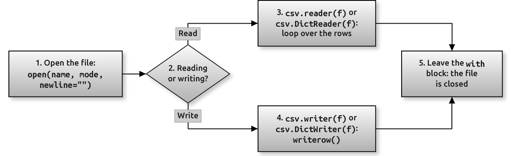

# Working with CSV Files Using the csv Module

A **CSV file** ("comma-separated values") is the simplest way to store a table as plain text: one row per line, with the values separated by commas. Spreadsheets such as Excel and Google Sheets can open and save CSV files, most websites that offer data for download offer CSV, and many of the datasets used in Chapter 12 are CSV files.

CSV looks so simple that it is tempting to read it with `split(",")`. That works until a value itself contains a comma, a quote or a line break, and then it quietly gives wrong results. Python's built-in **`csv` module** handles all of these cases correctly. This page shows how to use it.

By the end of this page you should be able to:

- explain why `split(",")` is not safe for CSV files;
- write rows to a CSV file with `csv.writer`, and read them back with `csv.reader`;
- use `csv.DictWriter` and `csv.DictReader` to work with columns by name instead of by position;
- open CSV files correctly, with `newline=""` and an encoding;
- read and write files that use a semicolon or a tab instead of a comma;
- convert the values you read (they always arrive as strings) and deal with missing or bad values;
- decide when to use the `csv` module and when to use pandas `read_csv()` from Chapter 12.

You need Chapter 10 (opening, reading and writing files) first. Section 8 uses `try`/`except` from Chapter 9 and `defaultdict` from Chapter 16.

## Table of Contents

- [Working with CSV Files Using the csv Module](160-ch10-csv-module.md#working-with-csv-files-using-the-csv-module)
    - [Key Terms Used on This Page](160-ch10-csv-module.md#key-terms-used-on-this-page)
    - [1. Why Not Just split(",")?](160-ch10-csv-module.md#1-why-not-just-split)
    - [2. The Usual Workflow](160-ch10-csv-module.md#2-the-usual-workflow)
    - [3. Writing a CSV File with csv.writer](160-ch10-csv-module.md#3-writing-a-csv-file-with-csvwriter)
        - [Why newline="" Matters](160-ch10-csv-module.md#why-newline-matters)
    - [4. Reading a CSV File with csv.reader](160-ch10-csv-module.md#4-reading-a-csv-file-with-csvreader)
    - [5. Working by Column Name: DictWriter and DictReader](160-ch10-csv-module.md#5-working-by-column-name-dictwriter-and-dictreader)
    - [6. Other Delimiters and Quoting](160-ch10-csv-module.md#6-other-delimiters-and-quoting)
    - [7. A Complete Example: Average Marks per Student](160-ch10-csv-module.md#7-a-complete-example-average-marks-per-student)
    - [8. Handling Missing and Bad Values](160-ch10-csv-module.md#8-handling-missing-and-bad-values)
    - [9. The csv Module or pandas?](160-ch10-csv-module.md#9-the-csv-module-or-pandas)
    - [10. Common Mistakes](160-ch10-csv-module.md#10-common-mistakes)
    - [Using the Code](160-ch10-csv-module.md#using-the-code)
    - [Conceptual Questions](160-ch10-csv-module.md#conceptual-questions)
        - [Question 1: A CSV File Is Plain Text. Why Do We Need a Module to Read It?](160-ch10-csv-module.md#question-1-a-csv-file-is-plain-text-why-do-we-need-a-module-to-read-it)
        - [Question 2: Why Does csv.reader Return '88' and Not 88?](160-ch10-csv-module.md#question-2-why-does-csvreader-return-88-and-not-88)
        - [Question 3: When Should You Use DictReader Instead of reader?](160-ch10-csv-module.md#question-3-when-should-you-use-dictreader-instead-of-reader)
        - [Question 4: What Exactly Goes Wrong Without newline=""?](160-ch10-csv-module.md#question-4-what-exactly-goes-wrong-without-newline)
        - [Question 5: How Would You Read a Tab-Separated File?](160-ch10-csv-module.md#question-5-how-would-you-read-a-tab-separated-file)
    - [Key Takeaways](160-ch10-csv-module.md#key-takeaways)
    - [Further Reading](160-ch10-csv-module.md#further-reading)

## Key Terms Used on This Page

| Term | Simple Meaning | Learn More |
| --- | --- | --- |
| CSV | A plain-text table: one row per line, values separated by a delimiter, usually a comma | [Python docs: csv](https://docs.python.org/3/library/csv.html) |
| Row | One line of the table, read as a list (or a dictionary) of values | |
| Header row | The first row, which holds the column names | |
| Delimiter | The character that separates the values: a comma, a semicolon or a tab | [Python docs: Dialects and formatting parameters](https://docs.python.org/3/library/csv.html#csv-fmt-params) |
| Quoting | Putting a value inside double quotes so that a comma inside it is not taken as a separator | [Python docs: csv.QUOTE_MINIMAL](https://docs.python.org/3/library/csv.html#csv.QUOTE_MINIMAL) |
| `csv.reader` / `csv.writer` | Read and write rows as lists | [Python docs: csv.reader](https://docs.python.org/3/library/csv.html#csv.reader) |
| `csv.DictReader` / `csv.DictWriter` | Read and write rows as dictionaries, keyed by the column names | [Python docs: csv.DictReader](https://docs.python.org/3/library/csv.html#csv.DictReader) |
| `newline=""` | An argument to `open()` that lets the `csv` module handle line endings itself | [Python docs: csv.reader](https://docs.python.org/3/library/csv.html#csv.reader) |
| Encoding | The rule for turning text into bytes on disk. `utf-8` is the safe choice | [Python docs: open()](https://docs.python.org/3/library/functions.html#open) |

[Back to the Table of Contents](160-ch10-csv-module.md#table-of-contents)

## 1. Why Not Just split(",")?

Here is one line from a CSV file. The city contains a comma, so the CSV format puts that value in double quotes.

```python
# Why not just split each line on commas?
line = 'Asha,"Pune, Maharashtra",88'

print(line.split(","))          # Wrong: the comma inside the quotes splits the city

import csv
print(next(csv.reader([line])))  # Right: the csv module understands the quotes
```

Output:

```text
['Asha', '"Pune', ' Maharashtra"', '88']
['Asha', 'Pune, Maharashtra', '88']
```

`split(",")` breaks the line at **every** comma, so the city is cut in two and the quotes stay in the values. The `csv` module knows that a comma inside quotes is part of the value, and it removes the quotes. With real data, from spreadsheets or downloads, this happens all the time: addresses, names such as "Gupta, Anurag", and amounts written as "1,500" all contain commas.

`csv.reader` usually reads from an open file, but it accepts any sequence of lines, which is why a list with one string works here.

[Back to the Table of Contents](160-ch10-csv-module.md#table-of-contents)

## 2. The Usual Workflow

Every program that uses the `csv` module follows the same few steps.



**Reading the figure**

- **Step 1:** Open the file with `open()`, always with `newline=""` and an encoding, inside a `with` block.
- **Step 2:** Decide whether you are reading or writing.
- **Step 3:** For reading, wrap the file in `csv.reader(f)` (rows as lists) or `csv.DictReader(f)` (rows as dictionaries), and loop over it.
- **Step 4:** For writing, wrap the file in `csv.writer(f)` or `csv.DictWriter(f)`, and call `writerow()` or `writerows()`.
- **Step 5:** When the `with` block ends, the file is closed and everything is saved.

**Run the scripts in order, in the same folder**, because later scripts read the files that earlier ones write.

[Back to the Table of Contents](160-ch10-csv-module.md#table-of-contents)

## 3. Writing a CSV File with csv.writer

`csv.writer(f)` gives an object with two methods: `writerow()` writes one row (a list), and `writerows()` writes a list of rows. Numbers are turned into text for you, and any value that contains a comma is put in quotes automatically.

```python
import csv

rows = [
    ["name", "city", "marks"],          # the header row
    ["Asha", "Pune", 88],
    ["Ravi", "Delhi, NCR", 75],          # a comma inside a value
    ["Meena", "Chennai", 92],
]

# newline="" stops blank lines appearing between rows on Windows
with open("students.csv", "w", newline="", encoding="utf-8") as f:
    writer = csv.writer(f)
    writer.writerows(rows)              # writerows() writes a whole list of rows

# Look at the raw text that was written
with open("students.csv", encoding="utf-8") as f:
    print(f.read(), end="")
```

Output:

```text
name,city,marks
Asha,Pune,88
Ravi,"Delhi, NCR",75
Meena,Chennai,92
```

Look at the third line: `"Delhi, NCR"` has been quoted because it contains a comma. The other values need no quotes, so they have none. This is the default behaviour, called `QUOTE_MINIMAL`.

### Why newline="" Matters

The CSV standard ends each row with two characters, `\r\n`, and the `csv` module writes exactly that. If you open the file **without** `newline=""`, Python on Windows turns each `\n` into `\r\n` as well, so every row ends in `\r\r\n`. Excel and other programs then show a **blank line between every row**. On Linux and macOS you would not notice the problem, which is why it catches people out.

The rule from the Python documentation is simple: **always open a CSV file with `newline=""`**, for reading and for writing.

[Back to the Table of Contents](160-ch10-csv-module.md#table-of-contents)

## 4. Reading a CSV File with csv.reader

`csv.reader(f)` gives one list per row. The header row is just the first row, so `next(reader)` reads it (or skips it) before the loop.

```python
import csv

with open("students.csv", newline="", encoding="utf-8") as f:
    reader = csv.reader(f)
    header = next(reader)               # the first row is the header
    print("Header:", header)
    for row in reader:                  # every other row is a list of strings
        print(row)

# Every value comes back as a STRING, even the marks
with open("students.csv", newline="", encoding="utf-8") as f:
    reader = csv.reader(f)
    next(reader)                        # skip the header
    total = sum(int(row[2]) for row in reader)   # convert before adding
print("Total marks:", total)
```

Output:

```text
Header: ['name', 'city', 'marks']
['Asha', 'Pune', '88']
['Ravi', 'Delhi, NCR', '75']
['Meena', 'Chennai', '92']
Total marks: 255
```

The most important point on this page: **every value comes back as a string.** The marks are `'88'`, not `88`. A CSV file is only text, so the `csv` module has no way of knowing that a column holds numbers. Before doing arithmetic, convert with `int()` or `float()`, as the last part of the script does. Forgetting this gives either a `TypeError` or, worse, string joining: `'88' + '75'` is `'8875'`.

[Back to the Table of Contents](160-ch10-csv-module.md#table-of-contents)

## 5. Working by Column Name: DictWriter and DictReader

Using `row[2]` for the marks is fragile: if someone adds a column, every position changes. `DictReader` reads the header row for you and gives each row as a dictionary, so you can write `row["marks"]` instead. `DictWriter` is the matching writer.

```python
import csv

# DictWriter: each row is a dictionary; fieldnames fixes the column order
students = [
    {"name": "Asha", "subject": "Maths", "marks": 88},
    {"name": "Ravi", "subject": "Maths", "marks": 75},
    {"name": "Asha", "subject": "Physics", "marks": 91},
]
with open("results.csv", "w", newline="", encoding="utf-8") as f:
    writer = csv.DictWriter(f, fieldnames=["name", "subject", "marks"])
    writer.writeheader()               # writes: name,subject,marks
    writer.writerows(students)

# DictReader: uses the header row as the keys of each dictionary
with open("results.csv", newline="", encoding="utf-8") as f:
    for row in csv.DictReader(f):
        print(row["name"], "scored", row["marks"], "in", row["subject"])
```

Output:

```text
Asha scored 88 in Maths
Ravi scored 75 in Maths
Asha scored 91 in Physics
```

Points to notice:

1. `fieldnames` tells `DictWriter` which keys to write and in which order. A dictionary with a key that is not in `fieldnames` raises `ValueError`.
2. `writeheader()` writes the column names. Without it the file has no header row, and `DictReader` would take the first data row as the header.
3. `DictReader` skips the header row automatically; the first dictionary is the first data row.
4. The values are still strings: `row["marks"]` is `'88'`.

For most real work, `DictReader` and `DictWriter` are the better choice, because the code says what each value means.

[Back to the Table of Contents](160-ch10-csv-module.md#table-of-contents)

## 6. Other Delimiters and Quoting

Not every "CSV" file uses commas. Files from European versions of Excel often use semicolons, because the comma is used there as the decimal point. Tab-separated files (`.tsv`) use the tab character, written `"\t"`. The `delimiter` argument handles all of these; use the same delimiter for reading as was used for writing.

```python
import csv

# Some files use another separator, for example a semicolon or a tab
with open("prices.csv", "w", newline="", encoding="utf-8") as f:
    writer = csv.writer(f, delimiter=";")
    writer.writerow(["item", "price"])
    writer.writerow(["tea", 12.5])
    writer.writerow(["coffee", 25])

with open("prices.csv", encoding="utf-8") as f:
    print(f.read(), end="")

with open("prices.csv", newline="", encoding="utf-8") as f:
    for row in csv.reader(f, delimiter=";"):   # read with the same delimiter
        print(row)

# QUOTE_NONNUMERIC: quote all text; when reading, turn unquoted values into float
with open("quoted.csv", "w", newline="", encoding="utf-8") as f:
    csv.writer(f, quoting=csv.QUOTE_NONNUMERIC).writerows([["tea", 12.5], ["coffee", 25]])

with open("quoted.csv", encoding="utf-8") as f:
    print(f.read(), end="")

with open("quoted.csv", newline="", encoding="utf-8") as f:
    for row in csv.reader(f, quoting=csv.QUOTE_NONNUMERIC):
        print(row)
```

Output:

```text
item;price
tea;12.5
coffee;25
['item', 'price']
['tea', '12.5']
['coffee', '25']
"tea",12.5
"coffee",25
['tea', 12.5]
['coffee', 25.0]
```

The second half of the script shows `quoting=csv.QUOTE_NONNUMERIC`. When writing, it quotes every value that is not a number. When reading, it turns every **unquoted** value into a `float`, which saves you a conversion step. Notice that `25` comes back as `25.0`: it is always a float, never an int.

| Quoting option | When writing | When reading |
| --- | --- | --- |
| `csv.QUOTE_MINIMAL` (default) | Quotes only values that need it (they contain the delimiter, a quote or a line break) | Removes the quotes |
| `csv.QUOTE_ALL` | Quotes every value | Removes the quotes |
| `csv.QUOTE_NONNUMERIC` | Quotes every non-numeric value | Converts unquoted values to `float` |
| `csv.QUOTE_NONE` | Never quotes; needs an `escapechar` if a value contains the delimiter | Does not treat quotes specially |

[Back to the Table of Contents](160-ch10-csv-module.md#table-of-contents)

## 7. A Complete Example: Average Marks per Student

This script reads `results.csv` (written in Section 5), works out each student's average, and writes the summary to a new CSV file.

```python
import csv
from collections import defaultdict

# Average marks per student from results.csv (made by cs04_dict.py)
totals = defaultdict(int)
counts = defaultdict(int)

with open("results.csv", newline="", encoding="utf-8") as f:
    for row in csv.DictReader(f):
        totals[row["name"]] += int(row["marks"])
        counts[row["name"]] += 1

# Write the summary to a new CSV file
with open("averages.csv", "w", newline="", encoding="utf-8") as f:
    writer = csv.writer(f)
    writer.writerow(["name", "average"])
    for name in sorted(totals):
        writer.writerow([name, round(totals[name] / counts[name], 1)])

with open("averages.csv", encoding="utf-8") as f:
    print(f.read(), end="")
```

Output:

```text
name,average
Asha,89.5
Ravi,75.0
```

How it works:

1. `DictReader` gives one dictionary per row of `results.csv`.
2. `defaultdict(int)` (Chapter 16) starts every new name at 0, so `totals[row["name"]] += ...` works without checking whether the name is already there.
3. `int(row["marks"])` converts the text to a number before adding.
4. A second `with` block writes the result with `csv.writer`, header first.

Asha took two subjects, so her average is (88 + 91) / 2 = 89.5. Ravi took one, so his average is 75.0.

[Back to the Table of Contents](160-ch10-csv-module.md#table-of-contents)

## 8. Handling Missing and Bad Values

Real CSV files are rarely clean. A value may be empty, or a column that should hold numbers may contain a word such as "absent". `int()` raises `ValueError` for both, so a single bad row would stop the whole program. Catch the error, keep the good rows, and report the rest.

```python
import csv

# A row with a missing value, and a row with a word where a number should be
with open("messy.csv", "w", newline="", encoding="utf-8") as f:
    f.write("name,marks\nAsha,88\nRavi,\nMeena,absent\nJohn,79\n")

good, skipped = [], []
with open("messy.csv", newline="", encoding="utf-8") as f:
    for row in csv.DictReader(f):
        try:
            good.append((row["name"], int(row["marks"])))
        except ValueError:                       # int("") and int("absent") both fail
            skipped.append(row["name"])

print("Read   :", good)
print("Skipped:", skipped)
```

Output:

```text
Read   : [('Asha', 88), ('John', 79)]
Skipped: ['Ravi', 'Meena']
```

`int("")` and `int("absent")` both raise `ValueError`, so one `except` handles both. The program reads every good row and lists the names it could not use, instead of crashing on the first problem. This is the EAFP style ("easier to ask forgiveness than permission") described on the page [LBYL versus EAFP](130-ch10-lbyl-eafp.md).

[Back to the Table of Contents](160-ch10-csv-module.md#table-of-contents)

## 9. The csv Module or pandas?

Chapter 12 reads CSV files with pandas: `pd.read_csv("file.csv")`. Both approaches are correct; they suit different jobs.

| | `csv` module | pandas `read_csv()` |
| --- | --- | --- |
| Installation | Built in | Needs pandas |
| Reads values as | Strings (you convert) | Numbers, dates and text, worked out for you |
| Memory | One row at a time, so it handles files of any size | Loads the whole table into memory (unless you read in chunks) |
| Best for | Simple scripts, very large files, writing CSV row by row, small programs that must not depend on extra packages | Analysis: filtering, grouping, averages, plotting |
| Speed of writing the code | More lines | One line to load, one to summarise |

A good rule: for **analysing** a table, use pandas; for **moving data** in and out of a program one row at a time, the `csv` module is simpler and lighter.

[Back to the Table of Contents](160-ch10-csv-module.md#table-of-contents)

## 10. Common Mistakes

| Mistake | What happens | Fix |
| --- | --- | --- |
| Using `line.split(",")` | Values that contain commas are split wrongly | Use `csv.reader` |
| Opening the file without `newline=""` | Blank lines between rows in Excel (on Windows) | Always open with `newline=""` |
| Forgetting that values are strings | `'88' + '75'` gives `'8875'`; `sum()` raises `TypeError` | Convert with `int()` or `float()` |
| Treating the header as data | `int("marks")` raises `ValueError` | `next(reader)` first, or use `DictReader` |
| Using `DictWriter` without `writeheader()` | The file has no column names | Call `writeheader()` once before the rows |
| Reading with the wrong delimiter | Each row comes back as one long value | Pass the same `delimiter` used when writing |
| Opening an Excel CSV that starts with odd characters, such as `name` | The first column name is wrong | Open it with `encoding="utf-8-sig"` |

The last row needs a word of explanation. Excel often saves "CSV UTF-8" files with three invisible bytes at the start, called a byte order mark. `encoding="utf-8-sig"` removes them when reading. Writing with `utf-8-sig` adds them, which helps Excel recognise the file as UTF-8 and show Hindi or other non-English text correctly.

[Back to the Table of Contents](160-ch10-csv-module.md#table-of-contents)

## Using the Code

Every script on this page is complete and ready to run. Copy it into a `.py` file or a notebook cell. The output shown under each script was produced by running it. Run the scripts in the order of the table, in the same folder; they create a few small `.csv` files, which you can delete afterwards.

| Script | Section | What it shows |
| --- | --- | --- |
| `cs01_why_csv.py` | 1 | Why `split(",")` fails |
| `cs02_write.py` | 3 | `csv.writer`, `writerows()` and automatic quoting |
| `cs03_read.py` | 4 | `csv.reader`, the header row, converting values |
| `cs04_dict.py` | 5 | `DictWriter` and `DictReader` |
| `cs05_delimiters.py` | 6 | Semicolons, and `QUOTE_NONNUMERIC` |
| `cs06_report.py` | 7 | A complete read, summarise and write program |
| `cs07_errors.py` | 8 | Skipping empty and bad values |

In Google Colab, the `.csv` files appear in the Files panel on the left, and you can download them and open them in a spreadsheet.

[Back to the Table of Contents](160-ch10-csv-module.md#table-of-contents)

## Conceptual Questions

### Question 1: A CSV File Is Plain Text. Why Do We Need a Module to Read It?

**Answer:** Because the format has rules that simple splitting ignores. A value may contain the delimiter, a double quote (written as two double quotes, `""`) or even a line break, and then it is wrapped in quotes. `csv.reader` follows these rules; `split(",")` does not, and gives wrong results without any error message.

### Question 2: Why Does csv.reader Return '88' and Not 88?

**Answer:** A CSV file stores only text. Nothing in the file says that a column holds numbers, so the module returns every value as a string and leaves the conversion to you. The one exception is `QUOTE_NONNUMERIC`, which turns unquoted values into floats. pandas goes further and guesses the type of each column for you.

### Question 3: When Should You Use DictReader Instead of reader?

**Answer:** Whenever the file has a header row and you want to refer to columns by name. `row["marks"]` is clearer than `row[2]`, and it still works if columns are added or reordered. Use `reader` for files without a header, or when you need the values strictly in order.

### Question 4: What Exactly Goes Wrong Without newline=""?

**Answer:** The `csv` module ends each row with `\r\n`. Opened without `newline=""` on Windows, the file object turns each `\n` into `\r\n` again, so the file contains `\r\r\n` at the end of every row. Programs such as Excel read that as an extra, empty row. When reading, leaving it out can also break values that contain a line break inside quotes.

### Question 5: How Would You Read a Tab-Separated File?

**Answer:** In the same way as a comma-separated one, with `delimiter="\t"`: `csv.reader(f, delimiter="\t")` or `csv.DictReader(f, delimiter="\t")`. Everything else, including `newline=""` and the encoding, stays the same.

[Back to the Table of Contents](160-ch10-csv-module.md#table-of-contents)

## Key Takeaways

| Idea | In one line |
| --- | --- |
| Open the file | `open(name, mode, newline="", encoding="utf-8")`, inside `with` |
| Read rows as lists | `csv.reader(f)`; `next(reader)` for the header |
| Read rows as dictionaries | `csv.DictReader(f)`; then `row["column"]` |
| Write rows | `csv.writer(f).writerow(row)` or `.writerows(rows)` |
| Write dictionaries | `csv.DictWriter(f, fieldnames=[...])`, `writeheader()`, then `writerows()` |
| Values you read | Always strings: convert with `int()` or `float()` |
| Other separators | `delimiter=";"` or `delimiter="\t"` |
| Bad values | Catch `ValueError` and skip or report the row |

[Back to the Table of Contents](160-ch10-csv-module.md#table-of-contents)

## Further Reading

- [Python docs: csv, CSV file reading and writing](https://docs.python.org/3/library/csv.html)
- [RFC 4180: the common format for CSV files](https://www.rfc-editor.org/rfc/rfc4180)
- [pandas docs: read_csv](https://pandas.pydata.org/docs/reference/api/pandas.read_csv.html), for the pandas way, used in Chapter 12
- [Working with Files and Folders Using pathlib](150-ch10-pathlib.md), the previous page
- [JSON versus Pickle](090-ch10-json-pickle.md), for two other ways of saving data to a file

[Back to the Table of Contents](160-ch10-csv-module.md#table-of-contents)
